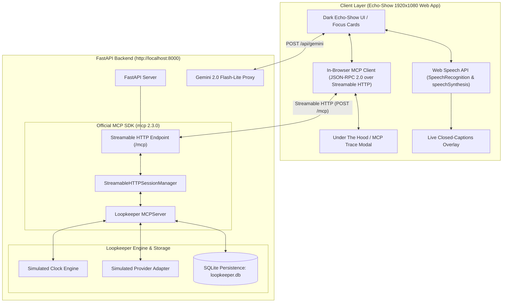

# ⚡ Loopkeeper — Autonomous Errand Closer

> **Finish the errands you keep putting off.** An autonomous voice assistant built on the official Model Context Protocol (MCP) Streamable HTTP transport and Google Gemini, designed with an Echo-Show-style dark interface.

[](https://modelcontextprotocol.io/)
[](https://github.com/modelcontextprotocol/python-sdk)
[](https://fastapi.tiangolo.com)
[](https://vercel.com)
[](LICENSE)

---

## 🎯 The Problem

Everyone has "open loops" — mundane, high-friction errands they procrastinate on: disputing unexpected recurring subscription charges, returning a purchased item before the warranty window closes, canceling gym memberships, or following up on repair estimates. These lingering tasks clutter our mental backlog, trigger background anxiety, and waste hard-earned money.

**Loopkeeper** acts as your personal errand closer:
1. **Captures open loops** through natural voice conversation or interactive text.
2. **Drafts outreach messages** using counterparty context and stored user preferences.
3. **Pauses for Human Approval**: In strict accordance with MCP safety hints (`destructiveHint=True`), side-effecting actions display an interactive **Approve & Edit card** before any external communication is dispatched.
4. **Tracks Asynchronous Responses**: Uses an internal simulated clock and provider adapter to deterministically model real-world business response delays.
5. **Delivers Daily Morning Briefings**: Summarizes newly received replies, active waiting states, and items requiring user attention.
6. **Closes the Loop**: Records positive outcomes and resolves the errand permanently in persistent SQLite storage.

---

## 🏗️ Architecture



---

## 🎬 7-Step Hackathon Rehearsal Flow (<10s per step)

Loopkeeper features a 1-click deterministic rehearsal pipeline designed for clean 1920x1080 screen recordings and live presentations:

| Step | Action | MCP Tool Call | Human Experience |
|:---|:---|:---|:---|
| **1. Capture Errand** | "Track an errand: FitLife Gym double-charged me $49." | `tools/call capture_errand` | Errand captured; status sets to `captured`. Voice confirms and captions display. |
| **2. Draft Outreach** | "Draft a message to FitLife Gym requesting a refund." | `tools/call draft_outreach` | Outreach drafted. **Approve Card pops up** with editable message. |
| **3. Approve & Send** | Click **"✓ Approve & Send"** | `tools/call send_outreach` | Message dispatched via Simulated Adapter. Status shifts to `waiting`. |
| **4. New Session** | Click **"New Session"** | UI Context Wipe | Proves memory: Dialogue wipes, SQLite database & errand state survive. |
| **5. What's Open?** | "What's open? What errands are on my plate?" | `tools/call list_open_loops` | Recalls both the pre-seeded Blender return and the active Gym dispute. |
| **6. Tomorrow Morning** | Click **"Tomorrow Morning"** | `advance_clock(1)` + `morning_brief` | Clock advances to Day 1. FitLife Gym replies confirming full $49 refund! |
| **7. Loop Resolves** | "Resolve gym errand as refund received." | `tools/call resolve_errand` | Loop completed! Errand marked `resolved` with celebratory glow. |
| **Under The Hood** | Click **"⚙ Under The Hood"** | Inspect MCP Trace | Displays verified protocol `2025-11-25`, runtime schemas, and JSON-RPC trace. |

> [!TIP]
> **Keyboard Shortcut**: Press `Spacebar` anywhere on the page to advance to the next rehearsal step instantly!

---

## 📺 Screen-Recording & Video Features

- **Large Live Captions**: High-contrast, glowing subtitle bar at the bottom center mirrors everything spoken aloud by the assistant, ensuring 100% clarity for muted viewers.
- **Glowing Waveform Visualizer**: Multi-bar animated waveform visualizes active listening and assistant speech.
- **One Focus Card at a Time**: Large typography cards highlight the current active errand state without visual clutter.
- **Visual 5-Step Stepper**: Each errand card visually tracks progress: `Captured` ➔ `Drafted` ➔ `Sent` ➔ `Waiting` ➔ `Resolved`.
- **Under The Hood Modal**: Live JSON-RPC message inspection, protocol version display, tool registry breakdown, and one-click trace copying.

---

## 🔒 Verified MCP Protocol Details

- **Protocol Version**: Negotiated `2025-11-25`
- **Transport**: Streamable HTTP at `/mcp` (`stateless_http=True`)
- **Official SDK**: `mcp` v2.3.0 (`from mcp.server.mcpserver import MCPServer`)
- **Exposed Tools (11)**:
  - `capture_errand(title, counterparty, details)` (`readOnlyHint=False, destructiveHint=False`)
  - `draft_outreach(errand_id, message)` (`readOnlyHint=False, destructiveHint=False`)
  - `send_outreach(errand_id, channel)` (`readOnlyHint=False, destructiveHint=True` — triggers Approval card)
  - `list_open_loops()` (`readOnlyHint=True, destructiveHint=False`)
  - `check_replies(errand_id?)` (`readOnlyHint=True, destructiveHint=False`)
  - `resolve_errand(errand_id, outcome)` (`readOnlyHint=False, destructiveHint=False`)
  - `advance_clock(days)` (`readOnlyHint=False, destructiveHint=False`)
  - `morning_brief()` (`readOnlyHint=True, destructiveHint=False`)
  - `remember_preference(key, value)` (`readOnlyHint=False, destructiveHint=False`)
  - `recall_preferences()` (`readOnlyHint=True, destructiveHint=False`)
  - `reset_demo()` (`readOnlyHint=False, destructiveHint=True`)
- **Exposed Resource**: `loops://open` (live open errands in formatted JSON)
- **Exposed Prompt**: `morning_brief` (dynamic morning brief template)

---

## ⚠️ Simulated Provider Disclosure

> [!NOTE]
> All counterparty communications (emails, SMS, customer portal messages) and replies in Loopkeeper are handled by an internal **Simulated Provider Adapter**. No real external emails or messages are sent. Counterparty replies are scripted and deterministic, and will only surface after the simulated clock is advanced by $\ge 1$ day using `advance_clock(days)`.

---

## 🚀 3-Command Local Setup

```bash
# 1. Install dependencies
pip install -r requirements.txt

# 2. Run automated test suite (verifies handshake, tools, gym flow, and restart persistence)
python tests/test_mcp.py

# 3. Launch application server
python -m uvicorn server:app --host 0.0.0.0 --port 8000
```

Open your browser to: **`http://localhost:8000`**

---

## ☁️ Vercel Deployment

Loopkeeper is configured for seamless zero-config deployment on Vercel:

1. Push your repository to GitHub (`https://github.com/Prajwalmdeepak7/loopkeeper`).
2. Import the project into your [Vercel Dashboard](https://vercel.com).
3. Under **Environment Variables**, add:
   - `GEMINI_API_KEY`: Your Google Gemini API Key (optional for Demo Mode, required for live free-form LLM voice).
4. Click **Deploy**. Vercel will automatically detect `vercel.json` and deploy `api/index.py` as a serverless ASGI FastAPI application with `/tmp` SQLite persistence.

---

## 🔑 Environment Variables

Copy `.env.example` to `.env`:

```env
# Optional for demo mode; required for live Gemini voice mode
GEMINI_API_KEY=your_gemini_api_key_here

# Optional: Custom SQLite path (defaults to loopkeeper.db locally, /tmp/loopkeeper.db on Vercel)
DATABASE_URL=loopkeeper.db
```

---

## 📄 License

[MIT](LICENSE) © 2026 Loopkeeper Team
